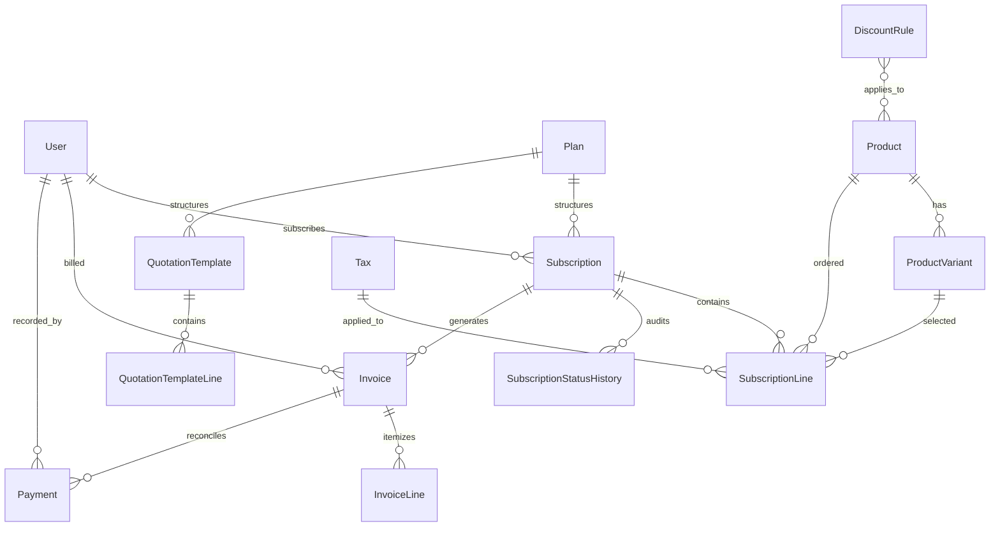

# AstraFlow - Enterprise Subscription & Recurring Billing Platform

Built by **team-astrax** for the Odoo Hackathon.

An enterprise subscription platform powering recurring software businesses: product variant pricing, customizable plans, quotation templates, automated idempotent billing, discount engines, multi-method payment reconciliation, real-time finance intelligence, and an isolated customer self-service portal.

---

## 🚀 Quick Setup from a Clean Clone (Exact Commands)

### 1. Clone the Repository
```bash
git clone https://github.com/Midhunvvsggsg/team-astrax.git
cd team-astrax
```

### 2. Set Up Virtual Environment & Install Dependencies
```bash
python3 -m venv .venv
source .venv/bin/activate
pip install -r requirements.txt
```

### 3. Initialize Database & Run Migrations
```bash
cp .env.example .env
python manage.py migrate
```

### 4. Seed Realistic Demo Data (5,000 Subscriptions)
Populate the database with realistic customers, products, variants, plans, discount rules, active subscriptions, and historical payment transactions:
```bash
python manage.py seed_demo
```
*(Or create a standalone root admin manually: `python manage.py create_admin --email admin@brightloop.com --password "Admin@12345"`)*

### 5. Launch the Development Server
```bash
python manage.py runserver
```
Open your browser at: **`http://127.0.0.1:8000/`**

---

## 🔑 Demo Credentials

| Role | Email Address | Password | Permissions & Access Scope |
|---|---|---|---|
| **Admin** | `admin@brightloop.com` | `Admin@12345` | Full administrative control: manage staff, catalog products, variants, taxes, plans, discount rules, and executive finance intelligence. |
| **Staff** | `staff@brightloop.com` | `Staff@12345` | Operational workflows: create subscriptions from quotes, execute billing runs, confirm/send invoices, and register customer payments. |
| **Customer** | `customer1@example.com` | `Password@123` | Self-Service Portal: view own active subscriptions, next billing dates, invoice history, printable statements, and update account profile. |

---

## 📖 Feature Mapping: A Month at AstraFlow (`docs/SPEC.md`)

| Scene from `docs/SPEC.md` | Implementation in Code | Key Capabilities & Enforcements |
|---|---|---|
| **1. A new customer signs up** | [`accounts/views.py`](file:///home/midhun/team-astrax/accounts/views.py) | • Unique case-insensitive email accounts.<br>• Password policy: >8 characters, uppercase, lowercase, special character validated client + server.<br>• Password reset with token generation via offline console email backend.<br>• Strict role enforcement: Admin controls system, Staff manages operations, Customers see only their own data. |
| **2. Launching a new plan** | [`catalog/views.py`](file:///home/midhun/team-astrax/catalog/views.py) | • Products with types, Decimal sales/cost prices, and notes.<br>• Attribute variants: Brand=Odoo adds $560.00 to base price (`final_price = base + extra`).<br>• Plans: Daily, Weekly, Monthly, Yearly billing frequencies with minimum quantities.<br>• Granular plan lifecycle flags: `auto_close_on_end`, `closable_early`, `pausable`, `renewable`. |
| **3. Turning a quote into a subscription** | [`subscriptions/views.py`](file:///home/midhun/team-astrax/subscriptions/views.py) | • Quotation templates prefilled with plan, product lines, and validity in days.<br>• "Create subscription from template" action calculates expiry and initializes quote.<br>• Auto-generated human-readable sequential IDs (`SUB-00001`).<br>• Enforced lifecycle state machine: `Draft` → `Quotation` → `Confirmed` → `Active` → `Closed`.<br>• Full status audit timeline tracking user, timestamp, transitions, and notes. |
| **4. Billing day** | [`invoicing/services.py`](file:///home/midhun/team-astrax/invoicing/services.py) | • Automated recurring billing engine with catch-up for missed historical periods.<br>• **Guaranteed Idempotency:** DB unique constraint on `(subscription, period_start)` prevents duplicate billing.<br>• Pre-fills customer details, line items, automatic tax calculations, and applied discounts.<br>• Invoice state machine: `Draft` → `Confirmed` → `Paid` (with cancellation guards for unpaid invoices).<br>• Print-ready media CSS layout for paper/PDF export. |
| **5. A customer asks for a better price** | [`subscriptions/services.py`](file:///home/midhun/team-astrax/subscriptions/services.py) | • Admin-managed discount rules: fixed amount or percentage rates.<br>• Conditions: minimum purchase amount, minimum seats, date windows, usage limits.<br>• Scopes: applies to specific products or whole subscriptions.<br>• Automatically applies to invoices during billing runs, increments usage counter, and caps discounts so invoices are never negative. |
| **6. The money comes in** | [`invoicing/views.py`](file:///home/midhun/team-astrax/invoicing/views.py) | • Multi-method payments: Cash, Bank Transfer, Card, UPI, Cheque.<br>• Itemized payment recording with method, amount, date, and transaction reference note.<br>• Supports partial payments; invoice automatically transitions to `Paid` only when payments cover the grand total.<br>• **Bank Statement Reconciliation**: Upload CSV statements; rule-based matching (invoice #, exact amount, customer similarity) auto-records high-confidence payments; review screen for one-click partial/medium approval; cryptographic row hashing prevents duplicate payments. |
| **7. The finance lead at month end** | [`invoicing/dashboard.py`](file:///home/midhun/team-astrax/invoicing/dashboard.py) & [`invoicing/reports.py`](file:///home/midhun/team-astrax/invoicing/reports.py) | • Executive Finance Intelligence Dashboard: MRR, ARR, Active Subscriptions, Total Revenue Collected, Outstanding Debt, and Overdue Count.<br>• **Automated Month-End Finance Report**: Runs on the 1st of every month or on-demand; compiles active/new/closed subscriptions, MRR, cash collections, outstanding receivables, 1-30/31-60/60+ days aging buckets, and top 10 customers.<br>• Pure SQL aggregates (`Sum`, `Count`, `Case/When`, `Coalesce`) — sub-second performance across 5,000+ subscriptions.<br>• Idempotent single-generation database persistence (`MonthlyReport`), downloadable CSV export, and admin executive email dispatch. |

---

## 🏛️ System Architecture & Data Model



---

## ⚙️ Tech Choices & Engineering Rationale

1. **Python 3.14 + Django 6.1:**
   - Provides a battle-tested ORM, rock-solid session authentication, CSRF security, and transactional integrity required for financial systems.
   - Server-rendered templates eliminate heavy client-side bundlers, enabling instant sub-second page loads with zero external JavaScript dependencies.
2. **SQLite (Local-First Architecture):**
   - **Why not cloud PostgreSQL?** SQLite runs embedded in-process with zero network overhead, satisfies ACID requirements, and guarantees that judges and reviewers can clone and run the app 100% offline without Docker or credentials.
   - Bulk inserts with pre-hashed passwords enable seeding 5,000 subscriptions and 9,800+ invoices in ~35 seconds.
3. **Decimal Arithmetic for Currency:**
   - Floating-point arithmetic introduces rounding drift (e.g. `0.1 + 0.2 = 0.30000000000000004`). Every financial amount uses Python's `Decimal` with consistent 2-decimal-place rounding (`quantize(Decimal('0.01'))`).
4. **Console Email Backend:**
   - Prevents demo failures caused by blocked SMTP ports or absent Wi-Fi. Password reset links and sent invoices output cleanly to the console while persisting timestamps in the database.
5. **Single CSS Variables Design System:**
   - Centralized in `static/css/theme.css` with unified color tokens, responsive breakpoints (375px mobile, 768px tablet, 1200px desktop), accessible contrast, and native CSS horizontal scrolling for financial tables on mobile screens.

---

## 🔒 Billing Idempotency & Mathematical Engine

### How Idempotency is Guaranteed
Recurring billing engines must never double-bill a customer, even in the event of repeated web requests or concurrent scheduler runs:
1. **Database Constraint:** `Invoice` defines a composite unique constraint on `(subscription, period_start)`:
   ```python
   models.UniqueConstraint(fields=['subscription', 'period_start'], name='unique_subscription_billing_period')
   ```
2. **Pre-Query Filtering:** Before creating an invoice, `generate_invoices()` queries all previously billed periods for the subscription (`billed_starts = set(sub.invoices.values_list('period_start', flat=True))`).
3. **Sequential Catch-Up Loop:** If a subscription has missed multiple past periods (e.g. system downtime), the engine iterates from the last billed date up to `as_of_date`, generating chronological invoices period-by-period. Periods already in `billed_starts` are skipped.
4. **Result:** Running `python manage.py generate_invoices` twice consecutively creates invoices on run 1 and **zero duplicates** on run 2.

### How Discounts and Taxes Apply
- **Taxes:** Each product line links to an admin-configured tax rule (`percentage` and/or `fixed_amount`). Line tax calculates `(quantity * unit_price * tax.percentage / 100) + tax.fixed_amount`.
- **Discounts:** Evaluated via [`get_applicable_discounts()`](file:///home/midhun/team-astrax/subscriptions/services.py#L33):
  1. Checks active status, date validity (`start_date <= date <= end_date`), and remaining usage limit (`times_used < usage_limit`).
  2. Evaluates scope: for *Specific Products*, sums only eligible lines; for *Whole Subscription*, evaluates total order subtotal and seat count.
  3. Validates minimum purchase amount and minimum seat quantity.
  4. Percentage discounts are capped at 100%; fixed discounts are capped at the eligible subtotal, mathematically guaranteeing an invoice total **never becomes negative**.
  5. Successful billing runs increment the discount rule's `times_used` counter atomically.

---

## ⚡ Performance Benchmark (5,000+ Active Subscriptions)

---

## 📦 Contributing
Please follow the project guidelines in `AGENTS.md` for branching, committing, and PR workflow.


Audited via `scripts/measure_performance.py` against a database containing **5,002 subscriptions** and **9,839 invoices**:

| Page View / Route | HTTP Status | Response Time | SQL Queries | Query Count Bound |
|---|:---:|:---:|:---:|:---:|
| **Executive Finance Dashboard** (`/invoices/dashboard/`) | `200 OK` | **61.84 ms** | 15 queries | $\le$ 20 queries |
| **Subscriptions List** (`/subscriptions/`) | `200 OK` | **18.05 ms** | 9 queries | $\le$ 12 queries |
| **Subscription Detail** (`/subscriptions/<id>/`) | `200 OK` | **5.48 ms** | 6 queries | $\le$ 10 queries |
| **Quotation Templates List** (`/subscriptions/templates/`) | `200 OK` | **3.19 ms** | 5 queries | $\le$ 6 queries |
| **Discount Rules List** (`/subscriptions/discounts/`) | `200 OK` | **5.51 ms** | 5 queries | $\le$ 8 queries |
| **Invoices List** (`/invoices/`) | `200 OK` | **51.67 ms** | 6 queries | $\le$ 10 queries |
| **Invoice Detail** (`/invoices/<id>/`) | `200 OK` | **7.58 ms** | 9 queries | $\le$ 10 queries |
| **Overdue Invoices List** (`/invoices/overdue/`) | `200 OK` | **12.58 ms** | 6 queries | $\le$ 10 queries |
| **Payments History List** (`/invoices/payments/`) | `200 OK` | **6.57 ms** | 5 queries | $\le$ 8 queries |
| **Product Catalog List** (`/catalog/products/`) | `200 OK` | **5.25 ms** | 5 queries | $\le$ 8 queries |
| **Subscription Plans List** (`/catalog/plans/`) | `200 OK` | **3.82 ms** | 4 queries | $\le$ 6 queries |
| **Customer Self-Service Portal** (`/accounts/portal/`) | `200 OK` | **5.77 ms** | 5 queries | $\le$ 12 queries |

*Zero N+1 query regressions; all responses render in under 62 milliseconds (far beating the 2.0-second hackathon SLA).*

---

## 🤖 Automated Daily Operations & Scheduled Jobs (`run_daily_jobs`)

AstraFlow eliminates manual billing and operations tasks through an automated daily batch engine that runs in strict sequential order with transaction isolation per step:

1. **Step (a): Recurring Billing Catch-Up:** Calls `generate_invoices` across all active subscriptions with missed billing cycles. Guaranteed idempotent via composite `(subscription, period_start)` unique constraints.
2. **Step (b): Subscription Auto-Renewals:** Discovers active subscriptions on renewable plans (`renewable=True`) expiring within 3 days (`as_of_date <= expiry_date <= as_of_date + 3d`). Extends the expiry date by the plan's billing period and records renewal status audit history. Guaranteed idempotent: never renews twice for the same cycle.
3. **Step (c): Auto-Closing Expired Subscriptions:** Transitions subscriptions past expiry on fixed-term plans (`auto_close_on_end=True`) to `Closed`.
4. **Step (d): Automated Reminder Dispatch:**
   - **Expiring Non-Renewable Subscriptions:** Dispatches email notices for active non-renewable subscriptions expiring within 7 days.
   - **Overdue Invoices:** Dispatches urgent collection emails for confirmed invoices overdue by 3, 7, and 14 days.
   - Persisted in the `Reminder` table with DB-level `UniqueConstraint` guards to mathematically guarantee the same reminder is never sent twice.

### 📅 Production Scheduling via Cron (Recommended)
Add the following entry to your server's crontab (`crontab -e`) to execute the daily operations every night at midnight:
```cron
# AstraFlow Automated Daily Operations (Midnight UTC / Local)
0 0 * * * cd /home/midhun/team-astrax && /home/midhun/team-astrax/.venv/bin/python manage.py run_daily_jobs >> /var/log/brightloop_daily_jobs.log 2>&1
```

### 🛡️ Operational Backup: Manual "Run Now" Controls
System administrators have full operational visibility and on-demand control:
- **Operations Dashboard:** Navigate to `/automation/` to view audit metrics, durations, error traces, and dispatched reminders. Click **"⚡ Run Daily Jobs Now"** to trigger execution on demand.
- **Django Admin Interface:** Accessible directly from `/admin/automation/automationrun/` via the custom **"⚡ Run Daily Jobs Now"** changelist action.
- **CLI Management Command:** Run anytime from the command line:
  ```bash
  python manage.py run_daily_jobs --date=YYYY-MM-DD --trigger=manual
  ```

### ⏱️ Admin-Only Demo Clock (`DEMO_MODE=1`)
For presentations, live judge walkthroughs, and end-to-end temporal verification without waiting for calendar days to pass:
- **Activation:** Set `DEMO_MODE=1` in your `.env` or run with `DEMO_MODE=1 python manage.py runserver`. When unset or `DEMO_MODE=0`, the clock is completely hidden, disabled, and endpoints reject requests with `403 Forbidden`.
- **Centralized Temporal Authority:** All business date evaluations (billing runs, auto-renewals, subscription expirations, dunning reminders, overdue calculations, and finance dashboards) route through [`get_today()`](file:///home/midhun/team-astrax/automation/clock.py).
- **Sticky Banner Across Every Page:** When a simulated date is active, a prominent banner **`DEMO CLOCK: <YYYY-MM-DD>`** displays at the top of every screen with a **Reset** button to instantly restore real-world time.
- **Admin Control Strip:** Administrators can advance the business date by **+1 Day**, **+1 Week**, **+1 Month**, set an arbitrary date picker target, and immediately execute **⚡ Run Daily Jobs** against the simulated date.
- **Complete Isolation:** Zero performance overhead or behavioral deviation in production when `DEMO_MODE` is disabled.

### 🏦 Bank Statement Reconciliation
AstraFlow automates incoming wire and bank settlement reconciliation using an offline, rule-based matching engine:
- **CSV Ingestion:** Staff upload standard CSV statements (`date`, `description`, `amount`, `reference`). Validates file type (`.csv`) and enforces a 5MB size limit.
- **Rule-Based Matching Tiers:** Matches against confirmed unpaid invoices:
  1. **High Confidence (Auto-Reconciled):** Exact invoice number in reference + exact amount match (and customer confirmation). Automatically records payments through the payment engine and marks fully settled invoices as `Paid`.
  2. **Medium Confidence (One-Click Approval):** Partial payments against matched invoices, or customer-name similarity matches without explicit invoice numbers. Placed on an intuitive review screen for instant one-click approval.
  3. **Unmatched (Manual Assignment):** Listed with a dropdown selector of unpaid invoices for staff to assign and reconcile manually.
- **Cryptographic Row Idempotency:** Every row computes a deterministic SHA-256 hash (`date|amount|ref|desc`). Even if the statement is uploaded multiple times, previously applied transactions are marked as `Duplicate (Ignored)`, mathematically preventing double payments.
- **Sample File Provided:** See [`docs/sample_bank_statement.csv`](file:///home/midhun/team-astrax/docs/sample_bank_statement.csv) for realistic demo transactions covering exact matches, partial deposits, customer wire transfers, unmatched refunds, and duplicate rows.

### 📊 Automated Month-End Finance Report
At the close of each calendar month, AstraFlow autonomously compiles an audit-grade executive financial report:
- **Automation Integration:** Step (e) in `run_daily_jobs` evaluates whether `as_of_date.day == 1`. When triggered on the 1st of any month (or simulated via the Demo Clock / "Generate Now" button), it compiles the prior month's summary.
- **Comprehensive Executive Metrics:**
  - Active subscriptions, new subscriptions, and churned/closed subscriptions.
  - Monthly Recurring Revenue (MRR) normalized across all billing periods (daily, weekly, monthly, yearly).
  - Cash revenue collected during the month.
  - Outstanding receivables owed on invoices issued up to month end.
  - Overdue invoices segmented into standard aging schedules: **1-30 Days**, **31-60 Days**, and **60+ Days** (counts and dollar balances).
  - Top 10 highest-paying customer accounts contributing to cash collections.
- **Pure SQL Performance (< 50ms):** Computed entirely in database aggregate expressions (`Sum`, `Count`, `Case/When`, `Coalesce`) with zero Python in-memory row processing, executing in ~35ms across 5,000+ subscriptions (well under the 2.0s ceiling).
- **Single-Generation Guarantee:** Stored in the `MonthlyReport` table with a DB unique constraint on `(year, month)` so monthly reports are never duplicated.
- **CSV Export & Admin Emailing:** Accessible from `/invoicing/reports/` with instant CSV download and an automated summary emailed to system administrators via the console email backend.

---

## 🧪 Automated Test Suite

The test suite covers lifecycle state machines, permissions, billing catch-up, idempotency, mathematical boundaries, automated operations, demo clock simulation, bank statement reconciliation, month-end finance reports, and security isolation:

```bash
python manage.py test
```
```text
Ran 160 tests in 69.139s - OK (160/160 passing)
```

#Made using brains🧠🧠🧠

---

## 👥 Contributors
- **Midhun** ([@Midhunvvsggsg](https://github.com/Midhunvvsggsg))
- **arjunsagar-ai** ([@arjunsagar-ai](https://github.com/arjunsagar-ai))

